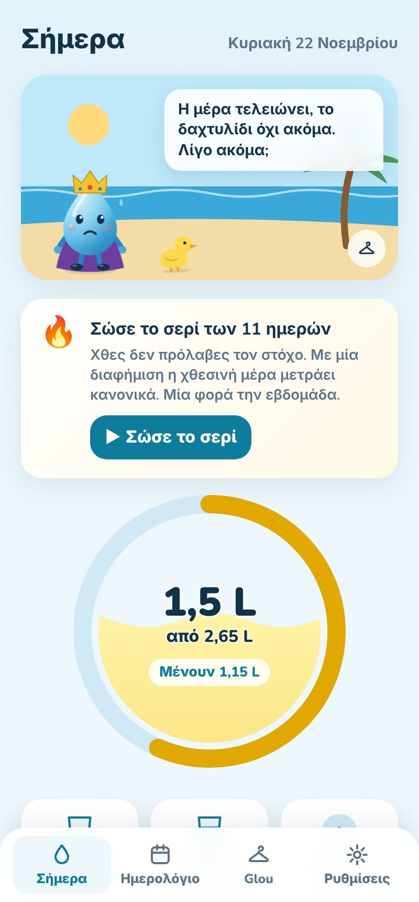
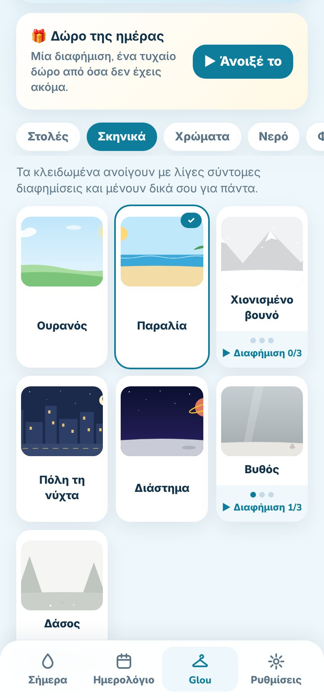
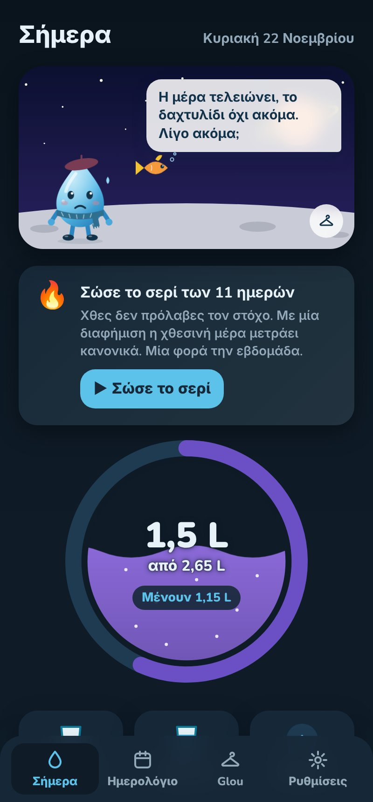
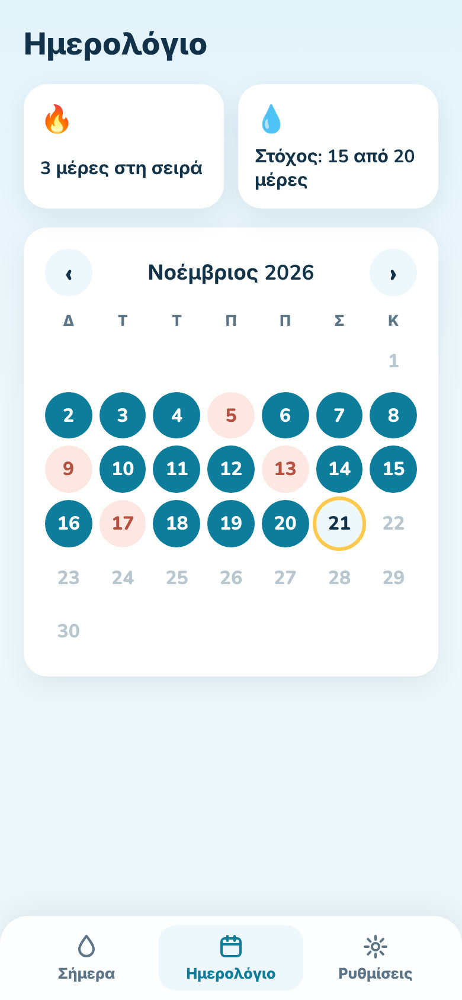

<h1 align="center">Glou</h1>

Εφαρμογή για το νερό της ημέρας, για Android, με μασκότ που ντύνεται με τον καιρό και σου μιλάει με ατάκες από την ελληνική μυθολογία.

  

  
  
  
  

## Εγκατάσταση

1. Από το κινητό σου, πάτα το κουμπί **Κατέβασέ το** πιο πάνω.
2. Άνοιξε το αρχείο `glou.apk` που κατέβηκε.
3. Αν το κινητό ρωτήσει, επίτρεψε την **εγκατάσταση από άγνωστες πηγές** για τον browser σου.
4. Πάτα **Εγκατάσταση**.

Για νέα έκδοση, κατέβασε ξανά το ίδιο link. Εγκαθίσταται πάνω από την παλιά και τα δεδομένα σου μένουν.

## Τι κάνει

- **Στόχος για σένα:** υπολογίζεται από το βάρος και την κίνησή σου, και ανεβαίνει τις πολύ ζεστές μέρες.
- **Υπενθυμίσεις που δεν ενοχλούν:** μόνο όσο είσαι ξύπνιος, σταματάνε όταν πιάσεις τον στόχο, και πατάς «Ήπια 250 ml» πάνω στην ειδοποίηση χωρίς να ανοίξεις την εφαρμογή.
- **Ο Glou:** ντύνεται με τον καιρό και τις γιορτές και σου μιλάει με πάνω από εκατό ατάκες.
- **Ημερολόγιο και σερί** για τις μέρες που πέτυχες τον στόχο.
- **Ντουλάπα:** στολές, σκηνικά, χρώματα, φίλοι για τον Glou και εικονίδια.
- **Τα δεδομένα σου μένουν στο κινητό.** Δεν υπάρχει λογαριασμός ούτε server.

> Το Glou δίνει μια γενική εκτίμηση και δεν αποτελεί ιατρική συμβουλή. Αν έχεις θέμα υγείας, είσαι έγκυος ή θηλάζεις, ακολούθησε τη συμβουλή του γιατρού σου.

---

**English:** Glou is a water tracker for Android with a mascot that dresses for the weather. [Download the APK](https://github.com/Nikpar005/glou-app/releases/latest/download/glou.apk), open it, allow installs from your browser if asked, and tap Install. The app is in Greek and English.

© 2026 Nikos Parliaros. All rights reserved.
